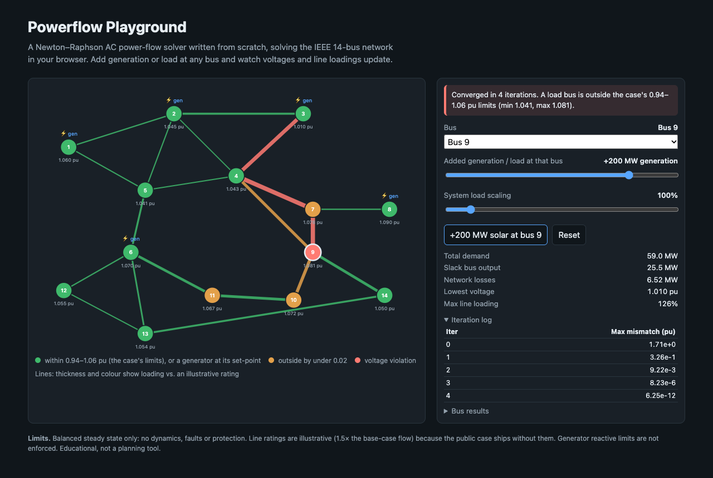

# powerflow-playground

> A Newton–Raphson AC power-flow solver written from scratch, running live in the browser.

**Status:** v0.1 core built; solver verified; UI checked in real Chrome



## The idea

Open the page, drag a slider to add 200 MW of solar at bus 9, and watch voltages and line loadings recolour live on a one-line diagram of the IEEE 14-bus network.

## Stack

TypeScript, Vite, SVG, Vitest.

Dev server binds to `0.0.0.0` on port **5192** so it's reachable over Tailscale (`vite --host 0.0.0.0 --port 5192 --strictPort`). Deploy to GitHub Pages.

## Build plan (v1)

- [x] Small complex-number and dense-matrix helpers (no solver library)
- [x] Parse the IEEE 14-bus case (MATPOWER format) into a typed model
- [x] Ybus construction, including transformer taps and line charging
- [x] Newton–Raphson with full Jacobian, mismatch tracking and iteration log
- [x] SVG one-line diagram coloured by voltage and line loading
- [x] Sliders for added generation/load (bus picker, MW slider, system load scaling, a "+200 MW solar at bus 9" preset) at chosen buses; recompute on change
- [x] Explicit "solver diverged" state instead of showing nonsense numbers

## Run it

```bash
npm install
npm run dev      # http://0.0.0.0:5192
npm test         # 7 tests
```

## How I know it's right

7 unit tests pass (`src/newton.test.ts`). Measured on the base case:

- Converges in **4 iterations**; max mismatch per iteration 9.2e-1 → 1.0e-1 → 7.1e-4 → 6.0e-8 → 7.1e-15 (quadratic).
- **Total loss 13.393 MW and slack output 232.39 MW** match the published case (13.393 / 232.4).
- Voltages and angles match the solution column stored in the case file within **1.3e-3 pu and 0.017°**. The largest gap is bus 4: the file holds the older IEEE reference value 1.019 while the converged solution is 1.0177 (MATPOWER prints 1.018). Every other bus is within 5e-4 pu, which is the rounding of that column.
- The status banner judges **load (PQ) buses only**; generator buses sit at their set-points (1.06–1.09 pu) and used to make the banner permanently red.
- Two-bus lossless case: `P = V₁V₂ sinδ / x` holds to 6 decimals.
- A load far beyond the nose point returns `converged: false` with a reason (no numbers shown).

Load scaling probe (all loads ×k): converges at k = 1 to 4 (min voltage 1.010 → 0.699 pu at ×4). The slider goes to ×6 so the diverged state is reachable; the lower solution branch at ×4 is a mathematically valid but practically meaningless operating point.

## Limits

**Line ratings are illustrative**: 1.5× the base-case flow (min 50 MVA), because the public case ships with none. Generator reactive limits are not enforced (the case's own solution violates bus 1's Qmin).

Balanced steady-state only. No dynamics, faults or protection. Educational, not a planning tool.

## Browser check

Checked in real Chrome (headless, driven with puppeteer) on 2026-10-12: the base case loads green with the case's own 0.94–1.06 pu limits (an earlier 0.95–1.05 band made the reference case itself look red: found by looking at it); the +200 MW solar preset flags a high-voltage load bus (min 1.041, max 1.081 pu, Q limits not enforced); ×6 load shows the diverged state. No console errors.

## Next (tomorrow)

- Bus labels sit close to lines in a few places; tidy the layout.
- Show per-line loading numbers on hover/tap; add the iteration log as a mini chart.
- Q-limit enforcement (PV→PQ switching) so high-load results are realistic.
- Contingency mode (click a line to trip it).

## Stretch

Contingency mode (click a line to trip it), IEEE 30-bus case, WebAssembly solver for speed.

## Definition of done

- [x] Hero GIF or screenshot at the top of this README (static screenshot; no GIF yet)
- [x] Live demo link or one-command run (`npm install && npm run dev`)
- [ ] "How I know it's right" section filled in with real results
- [ ] Tests passing in CI, badge added
- [ ] "Limits" section written
- [ ] Licence chosen, repo description and topics set
- [ ] Pinned on GitHub profile and added to guinerve.github.io
- [ ] Added to `career-radar/data/cv/portfolio.json`
