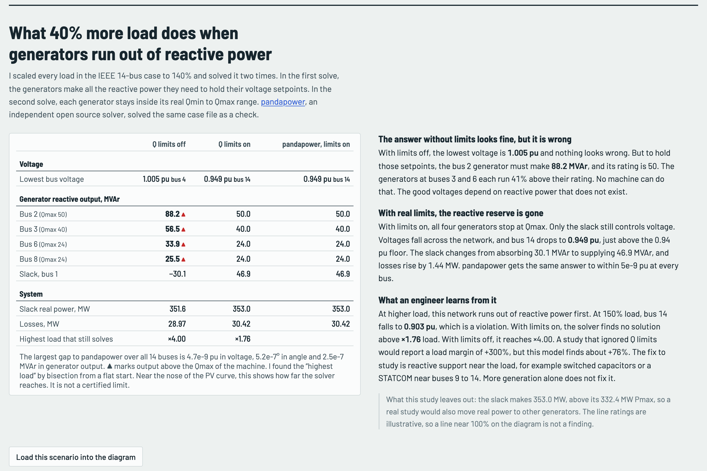
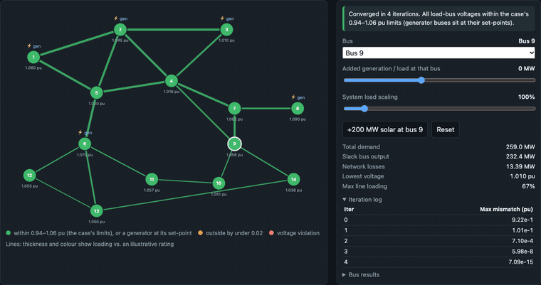

# Powerflow Playground

An AC power flow solver that I wrote from scratch in TypeScript. It solves the IEEE 14-bus network in your browser each time you move a control.

[](https://github.com/Guinerve/powerflow-playground/actions/workflows/ci.yml)
[](https://guinerve.github.io/powerflow-playground/)
[](LICENSE)

**[Open the live demo](https://guinerve.github.io/powerflow-playground/)**


I built this to show what happens inside a power flow study, and to check that I could get the numbers right without a library. The solver uses Newton's method in polar form. It enforces generator reactive limits by switching buses between PV and PQ. A test suite checks every bus against pandapower, an independent solver.

The solver has its own code for each part:

- the bus admittance matrix (π model lines, transformer tap ratios and bus shunts)
- the full polar Jacobian
- Gaussian elimination with partial pivoting
- an outer loop that switches generator buses between PV and PQ at their reactive limits

## Quick start

```bash
npm install
npm run dev      # http://localhost:5192
```

Open the page, then:

1. Select a bus on the diagram.
2. Move the slider to add generation or load at that bus.
3. Move **System load** to scale every load in the case.
4. Clear **Enforce generator reactive limits** to see the answer without limits.

## Worked scenario: 140% load and generator reactive limits

I scaled every load in the case to 140%, for both P and Q. Generator MW stays the same, so the slack supplies the rest. Then I solved the case two times. In the first solve, the generators make all the reactive power they need to hold their voltage setpoints. In the second solve, each generator stays inside its real Qmin to Qmax range. [pandapower](https://www.pandapower.org/) solved the second case again from the same `case14.m` file.



| | Q limits off | Q limits on (this solver) | pandapower, limits on |
|---|---:|---:|---:|
| Lowest bus voltage | 1.005 pu (bus 4) | **0.949 pu (bus 14)** | 0.949 pu (bus 14) |
| Bus 2 generator Q (Qmax 50 MVAr) | 88.2 ▲ | 50.0, at Qmax | 50.0 |
| Bus 3 generator Q (Qmax 40) | 56.5 ▲ | 40.0, at Qmax | 40.0 |
| Bus 6 generator Q (Qmax 24) | 33.9 ▲ | 24.0, at Qmax | 24.0 |
| Bus 8 generator Q (Qmax 24) | 25.5 ▲ | 24.0, at Qmax | 24.0 |
| Slack Q, bus 1 | −30.1 | 46.9 | 46.9 |
| Losses | 28.97 MW | 30.42 MW | 30.42 MW |
| Highest load the solver can still solve | ×4.00 | **×1.76** | |

▲ marks output above the rating of the machine. Over all 14 buses, the largest gap to pandapower is 4.7e-9 pu in voltage, 5.2e-7° in angle and 2.5e-7 MVAr in generator output.

**What it shows.** With limits off, the network looks healthy. The lowest voltage is 1.005 pu. But the bus 2 generator must make 88 MVAr, and its rating is 50 MVAr. The generators at buses 3 and 6 must each make 41% more than they can. With limits on, all four voltage control generators stop at Qmax. Only the slack still controls voltage, so voltages fall across the network. Bus 14 drops to 0.949 pu, just above the 0.94 pu floor of the case. The slack changes from absorbing 30 MVAr to supplying 47 MVAr, and losses rise by 1.44 MW.

**Engineering reading.** At higher load, this network runs out of reactive power first. At 150% load, bus 14 falls to 0.903 pu, which is a violation. With limits on, the solver finds no solution above ×1.76 load. With limits off, it reaches ×4.00. A study that ignored Q limits would report a load margin of +300%, but this one finds about +76%. The fix to study is reactive support near the load, for example switched capacitors or a STATCOM near buses 9 to 14. More generation alone does not fix it.

**What this leaves out.** At 140% load the slack makes 353 MW, and its Pmax is 332.4 MW. A real study would also move real power to other generators. The line ratings are illustrative (see [Limits](#limits)), so a line near 100% on the diagram is not a finding. I found the "highest load" values by bisection on convergence from a flat start. Near the nose of the PV curve, they show how far the solver reaches. They are not certified loadability limits.

On the page, the **140% load** button loads this case into the diagram.



## How it works

| File | What it does |
|---|---|
| [`src/model.ts`](src/model.ts) | Reads the MATPOWER case format (bus, gen, branch) into typed records |
| [`src/ybus.ts`](src/ybus.ts) | Builds the bus admittance matrix: π model lines, transformer taps, bus shunts |
| [`src/newton.ts`](src/newton.ts) | Newton's method in polar form, branch flows and the reactive limit loop |
| [`src/status.ts`](src/status.ts) | Turns a solution into the status banner |
| [`src/scenario.ts`](src/scenario.ts) | The worked scenario and the loadability bisection |
| [`src/main.ts`](src/main.ts) | The one-line diagram (SVG), the controls and the charts |
| [`reference/generate.py`](reference/generate.py) | Builds the pandapower reference in `src/reference/case14.json` |

**Reactive limits.** In the API, set `enforceQLimits: true` to turn them on. They are off by default, as in MATPOWER and pandapower. The app turns them on by default.

1. After each solve that converges, the solver checks each PV bus.
2. If its generator needs more than Qmax or less than Qmin, the bus becomes a PQ bus with Q fixed at that limit.
3. The solver solves the case again, starting from the last answer.
4. A limited bus goes back to PV if its voltage moves past its setpoint in the direction that means it has spare reactive power.
5. The loop stops when nothing changes. After 20 passes, it reports that the case did not converge.

The solver adds together the limits of all generators at one bus. It reports the slack Q against its limits but never enforces them, because the slack must balance the system. In the published base case, bus 1 already absorbs 16.5 MVAr against a Qmin of 0.

**When it does not converge.** The page says that the solver failed and shows no numbers. It also gives the reason. For example:

- the mismatch grew
- the Jacobian became singular
- a voltage fell below 0.05 pu during the iterations
- the iteration limit ran out
- generators kept switching at their limits for 20 passes

A failed solve from a flat start often means the demand is past the nose of the PV curve. But it does not prove that no solution exists. A power flow also says nothing about dynamic stability, so the page never calls an operating point "stable" or "unstable".

## How I know it is right

`npm test` runs 38 tests in four files.

- **Published case.** The base case converges in 4 iterations. The largest mismatch falls 0.92, 0.10, 7.1e-4, 6.0e-8, 7.1e-15 pu, which is quadratic. Total loss is 13.393 MW and slack output is 232.39 MW, against the published 13.393 and 232.4. Voltages are within 1.3e-3 pu of the solution stored in the case file. The largest gap is at bus 4: the file holds the older IEEE value of 1.019, and the solver gives 1.0177 (MATPOWER prints 1.018).
- **Independent solver.** Four cases match pandapower 3.5.6 to 1e-6 pu at every bus: the base case, 140% without limits, 140% with limits and 150% with limits. The measured gap is about 5e-9 pu. Angles match to 1e-4°, generator Q to 1e-3 MVAr, and slack power and losses to 1e-3 MW. The reference uses the same `case14.m`, read by a separate parser in `reference/generate.py`.
- **Hand calculations.** On a lossless line between two buses, P = V₁V₂ sin δ / x holds to 6 decimals. A PV bus that holds 1.05 pu over x = 0.1 pu needs exactly 52.5 MVAr. With a cap of 20 MVAr, its voltage lands on the root of V² − V − 0.02 = 0. A 0.9 pu setpoint with a cap of 10 MVAr absorption lands on the root of V² − V + 0.01 = 0. That voltage is above the setpoint, which the generator cannot reach.
- **Self consistency.** In a sweep from 50% to 160% load, every regulating generator stays inside its range. Every generator at Qmax sits at or below its setpoint, and every generator at Qmin sits at or above it.
- **The numbers in this README.** `src/scenario.test.ts` checks the scenario figures above. If the solver changes them, the build fails.

To make the reference again:

```bash
uv run --python 3.12 --with pandapower==3.5.6 python reference/generate.py
```

## Development

```bash
npm test         # 38 tests
npm run build    # type check, then a static site in dist/
npm run preview  # serve dist/ on port 5192
```

Each push to `main` runs the tests and deploys `dist/` to GitHub Pages.

## Limits

- **Line ratings are illustrative.** Each rating is 1.5× the base case flow, at least 50 MVA, because the public case has no ratings.
- The solver does not enforce generator real power limits (Pmin and Pmax). The slack supplies all extra load.
- It models a balanced, positive sequence steady state only. It has no dynamics, faults, protection, tap changers or switched shunts.
- The parser refuses phase shifting transformers and skips elements that are out of service.
- It uses dense matrices and Gaussian elimination. That is fine for 14 buses, but it would not scale to large networks.
- It is for learning. Do not use it to plan a real network.

## Licence

MIT. See [LICENSE](LICENSE).
